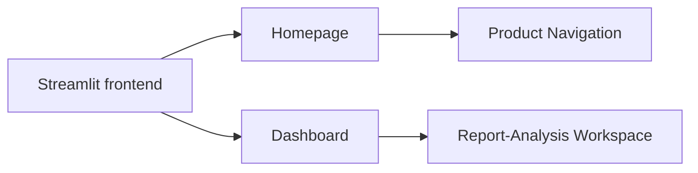
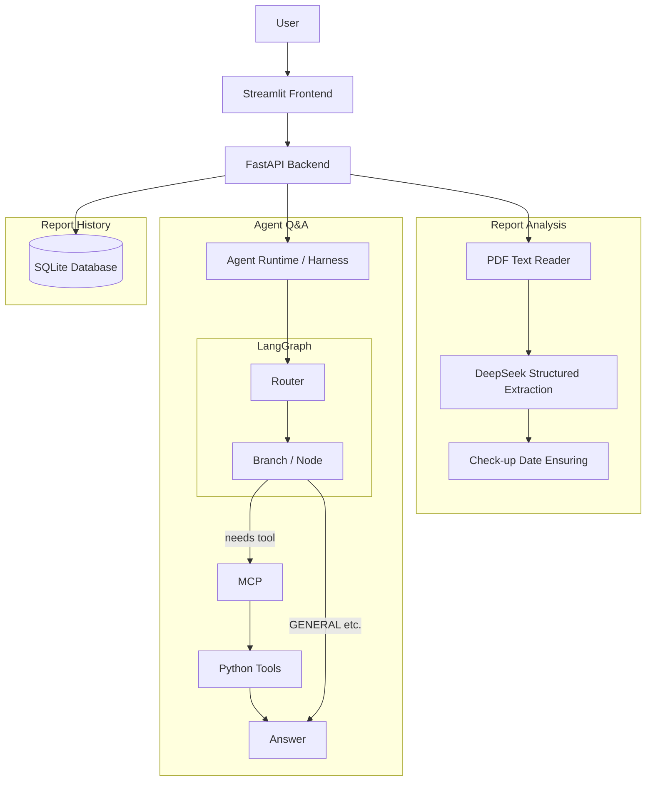

# HealthBrief

**HealthBrief is a personal health report agentic copilot. Core functions includes extracting reports,structuring biomarker summaries, trend comparisons, and interactive report Q&A.**

> Note: HealthBrief is a generative LLM model-based product and does not ensure 100% accuracy of medical diagnosis or medical advice. Please call with your clinicians to determine the final diagnosis.

---

## Overview

Health reports often contain useful information, but the data is fragmented across PDFs, reference ranges, and repeated check-ups.

HealthBrief provides a lightweight workflow for users to:

- upload a text-based PDF health report;
- extract structured biomarker data;
- identify values outside the provided reference range;
- save reports for later comparison;
- compare biomarkers across two check-ups;
- ask natural-language questions about the current report;
- prepare more informed questions for a future doctor visit.

The project focuses on **AI application architecture rather than medical diagnosis**.


## LLM Model Selection

Model **deepseek-flash** ( DeepSeek-V4.1-Flash-1017 ver.) is applied in the context of semantic interpretation including:  

- extracting structured information from report text;
- classifying the user's question category;
- generating natural-language explanations.


---


## Core Features

### Upload and Analyze Current Report 

Users can upload a text-based ( OCR function does not support currently ) PDF report and convert unstructured text into structured biomarker data.

For each item, HealthBrief extracts fields such as: biomarker name / measured value / unit / lower reference bound / upper reference bound.

The application then classifies each value as low / high / normal.

Reference-range classification is handled by deterministic Python logic rather than the language model.

---

### Biomarker Visualization

Extracted biomarkers are presented in a structured report overview including biomarker values / units / reference ranges / status / total biomarker count / markers requiring attention / detected check-up date when available.

Users can also inspect the full extracted PDF text.

---

### Report History

HealthBrief supports persistent report history using SQLite.

Users can:

- explicitly save an analyzed report;
- view previously saved reports;
- load a saved report as the comparison report;
- delete saved reports.

The current implementation intentionally uses explicit user-triggered saving rather than automatically persisting every uploaded health report.

---

### Trend Comparison

A user may provide one previous report either by:

- uploading an older PDF; or
- selecting a report from saved history.

HealthBrief can then compare a biomarker between the current and previous reports.

The deterministic comparison tool calculates information such as:

- previous value;
- current value;
- absolute change;
- percentage change;
- previous status;
- current status.

Numerical value changes and comparison keeps logical coding without LLM.

---

### Ask HealthBrief

Users can ask questions such as:

- “Why is my LDL high?”
- “Which biomarkers are outside the reference range?”
- “Has my LDL improved since my previous report?”
- “What should I discuss with my doctor?”
- “hello?"

A LangGraph workflow classifies each question into a supported category and routes it to the appropriate tool or response path.


---

## Architecture

HealthBrief uses a multipage Streamlit frontend and a FastAPI backend for main analysis.

The frontend is separated into:




The benckend structure is:


Part of nodes will be described in detail later.

---

### Agent Workflow

The LangGraph agent maintains structured state including: user question / current report / optional previous report / selected category / selected biomarker / tool result / generated answer / execution trace.

A typical trend-comparison request follows this path:

```text
User question
   ↓
Category Router
   ↓
MCP tool call
   ↓
Deterministic comparison result (if any)
   ↓
LLM-generated explanation
```

---

### MCP Tool Layer

HealthBrief exposes its deterministic analysis functions through MCP tools. The LangGraph agent calls these tools through the MCP client rather than importing the analysis functions directly. Current tools include:

- `find_biomarker`
- `get_abnormal_markers`
- `compare_biomarker`
- `prepare_visit_context`

For a project of this size, direct Python calls would be simpler. MCP was used here to experiment with a standardized tool interface and to separate orchestration from tool execution.

---

## Error Handling and Execution Tracing

HealthBrief uses structured application errors rather than returning generic failures for every case.Examples include: missing previous report / PDF reading failure / model service failure / invalid model response / MCP tool failure / unexpected agent execution failure.API errors are mapped into structured FastAPI responses with: error code / user-facing message / request ID.


---

## Evaluation

The category router was evaluated using a manually labelled set of 20 representative user questions.

On this small evaluation set:

- **Category accuracy:** 100%
- **Average routing latency:** approximately 1.05 seconds

This result describes performance only on the current labelled evaluation set and should not be interpreted as universal routing accuracy.

The project also includes:

- unit tests for deterministic tools;
- an integration test covering the backend agent stack;
- manual end-to-end smoke testing for report upload, comparison, persistence, and Q&A workflows.


---

## Technology Stack

### Frontend
- Streamlit
- HTML / CSS
- Requests
- Pandas

### Backend
- Python
- FastAPI
- Pydantic

### AI / Agent
- DeepSeek API
- LangGraph
- Model Context Protocol (MCP)

### Data
- SQLite
- SQLAlchemy

### PDF Processing
- pypdf

### Testing
- pytest

---

## Project Structure

```text
healthcare-ai-agent-vault/
│
├── frontend/
│   └── app.py
│
├── backend/
│   ├── main.py
│   ├── schemas.py
│   ├── database.py
│   ├── mcp_server.py
│   ├── mcp_client.py
│   │
│   ├── harness/
│   │   ├── runtime.py
│   │   ├── logging_config.py
│   │   └── errors.py
│   │
│   └── services/
│       ├── agent.py
│       ├── router.py
│       ├── tools.py
│       ├── lab_extractor.py
│       └── pdf_reader.py
│
├── tests/
│   └── test_integration.py
│
├── evaluation/
│   ├── questions.json
│   └── evaluate_router.py
│
└── README.md
```

---

## Running the Project

### 1. Create and activate a virtual environment

Example:

```bash
python -m venv healthbrief_env
```

Activate it using the appropriate command for your operating system.

---

### 2. Install dependencies

```bash
pip install -r requirements.txt
```

---

### 3. Configure the model API

Create a `.env` file and provide the required API credentials.

Do not commit API keys to Git.

---

### 4. Start the FastAPI backend

From the project root:

```bash
uvicorn backend.main:app --reload
```

FastAPI documentation is available locally at:

```text
http://127.0.0.1:8000/docs
```

---

### 5. Start the Streamlit frontend

In a second terminal:

```bash
streamlit run frontend/app.py
```

---


## Future Improvements

Potential extensions include:

- OCR support for scanned reports;
- multi-report longitudinal trend analysis;
- interactive biomarker trend charts;
- more systematic model and tool evaluation;
- user authentication and isolated report storage;
- stronger report deduplication using content hashes;
- migration from SQLite to a production database if multi-user deployment is required.

These features are intentionally outside the current project scope.


---

## Disclaimer

HealthBrief is an educational software project.

It is not a medical device and does not provide medical diagnosis, treatment recommendations, or professional medical advice.

Users should consult qualified healthcare professionals when making medical decisions.